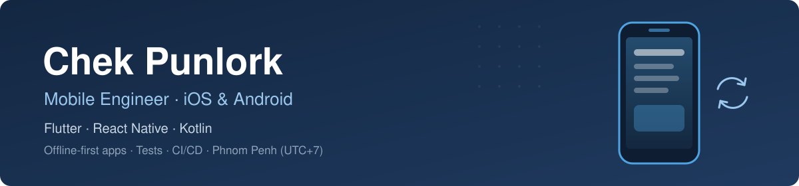

  

  
  
  

### About me

Mobile engineer with 4+ years building iOS and Android apps. I like apps that keep working when the network doesn't: offline-first data, sync that never drops a write, and enough tests and CI that shipping is boring. I also write things down (architecture docs, decision records, clear PRs) so a team can work with me asynchronously.

- 🔭 **Now:** leading the mobile architecture of an enterprise loan management app in Flutter, used offline by loan officers in the field
- 🌏 **Based in:** Phnom Penh, Cambodia (UTC+7), working in English

### Featured work

<table>
  <tr>
    <td width="50%" valign="top">
      <h3><a href="https://github.com/Punlork/Jabhouy">Jabhouy</a></h3>
      
Offline-first shop management app: inventory, sales and customer loans, in Khmer and English.

      <ul>
        <li>Outbox sync engine in pure Dart: saves to SQLite at once, syncs on reconnect with retry and backoff</li>
        <li>400+ tests: unit, BLoC, widget, migration, Patrol</li>
        <li>CI on every PR, signed releases with Fastlane</li>
        <li>Kotlin bridge reading bank notifications</li>
        <li><a href="https://github.com/Punlork/Jabhouy/blob/main/ARCHITECTURE.md">Architecture guide</a> and decision records</li>
      </ul>
      
      
      
      
    </td>
    <td width="50%" valign="top">
      <h3><a href="https://pub.dev/packages/flutter_runtime_debugger">flutter_runtime_debugger</a></h3>
      
On-device debugger for Flutter apps, published on pub.dev.

      <ul>
        <li>Logs, network, BLoC state, crashes, FPS, routes and local storage in an in-app overlay</li>
        <li>No DevTools or USB cable needed</li>
        <li>Zero dependencies, plugin-based tabs</li>
        <li>Access tiers per build environment</li>
      </ul>
      
      
    </td>
  </tr>
</table>

### Tech stack

**Mobile** 

**Data and backend services** 

**Testing and delivery** 

**Also** 

